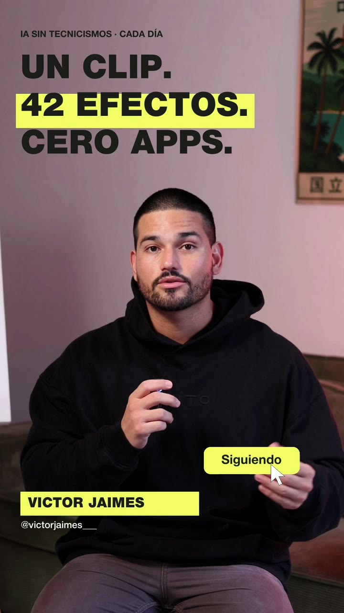

# Efectos para Claude · 42 efectos de vídeo en español



Un clip. 42 efectos. Cero apps.

Una skill para **Claude Code** que añade efectos a tus vídeos hablando a cámara: widgets de vidrio, tus reels flotando a tu alrededor, zooms que se clavan en tu cara, portada tipo serie, checklist, toggles de iPhone, titulares y más. Siguen tu cara, pueden ir detrás de tu cabeza y salen en 1080p o 4K con tu audio original.

Todo en español: las instrucciones y los textos que aparecen dentro de los efectos.

## Cómo instalarla
1. Descarga este repo (botón verde **Code → Download ZIP**) o clónalo:
   ```bash
   git clone https://github.com/victorpeel-ux/efectos-claude ~/efectos-claude
   ```
2. Abre Claude Code y dile: *"Instala la skill de efectos que está en ~/efectos-claude"*.
3. Arrastra tu vídeo al chat y escribe, por ejemplo: `/efectos orbit` o *"pon CLAUDE gigante detrás de mí en la palabra Claude"*.

La primera vez instala lo que necesita (ffmpeg y Python 3.12) y tarda 1–3 minutos.

## Cómo funciona
Tú no tocas ningún editor. Le hablas a Claude y él hace esto por debajo:

1. **Encuentra tu cara en cada fotograma.** Un modelo de detección (YuNet) sabe dónde está tu cabeza en todo momento, así los efectos te siguen aunque te muevas.
2. **Te recorta del fondo.** Otro modelo (MediaPipe) separa tu silueta de la pared. Por eso una palabra gigante o unas tarjetas pueden ir *detrás* de tu cabeza y no encima.
3. **Arma un plan.** Claude escribe un pequeño archivo con qué efecto va, en qué segundo empieza y termina, y con qué texto o colores. Si le dices "en la palabra Claude", transcribe tu audio y lo coloca justo ahí.
4. **Te enseña una prueba antes de renderizar.** Saca unos fotogramas del resultado, los revisa y corrige si algo tapa tu cara o se corta.
5. **Renderiza el vídeo final** en 1080p o 4K, con tu audio original intacto.

Un ejemplo real de conversación:

```
Tú:     /efectos glass-widgets del segundo 1 al 4 y luego orbit con mis reels
Claude: Listo. Te pongo los widgets alrededor de tu cabeza y en el 11 s tus 6 reels
        orbitando. Mira estos dos fotogramas antes de renderizar.
Tú:     perfecto, dale
Claude: Hecho: mi-video_efectos.mp4 (1080×1920, 36 s)
```

Puedes pedir varios efectos en el mismo vídeo, cambiar textos y colores, o decir "más rápido", "más arriba" o "en amarillo" hasta que te guste.

## Ideas para empezar
- `glass-widgets`: widgets de vidrio alrededor de tu cabeza (vistas, render, tu perfil).
- `orbit`: tus reels girando a tu alrededor. Pásale capturas de tus mejores reels.
- `locked-on`: esquinas que se clavan en tu cara y la cámara te sigue con zoom.
- `todo` / `apple-toggles`: checklist o ajustes de iPhone que se van marcando mientras hablas.
- `split-headline`: titular arriba, tú abajo.

La lista completa de los 42 está en [`SKILL.md`](SKILL.md).

## Qué necesitas
- Claude Code con un plan de pago de Claude.
- Mac o Windows.
- Un vídeo vertical tuyo hablando a cámara.

## Créditos
Basado en el pack open source **[claude-video-effects](https://github.com/Vibha-Ramprakash/claude-video-effects)** de [@vibha.in.progress](https://www.instagram.com/vibha.in.progress/) (licencia MIT). Esta versión la traduce al español y ajusta textos y estilo.

Detección de cara: [OpenCV YuNet](https://github.com/opencv/opencv_zoo) (MIT). Recorte de persona: [MediaPipe Selfie Segmenter](https://ai.google.dev/edge/mediapipe/solutions/vision/image_segmenter) (Apache 2.0). Fuentes con licencia SIL OFL / Apache 2.0 (ver `fonts/`).

Hecho por **Victor Jaimes** · IA y negocio en [@victorgrowth_](https://www.instagram.com/victorgrowth_/).
